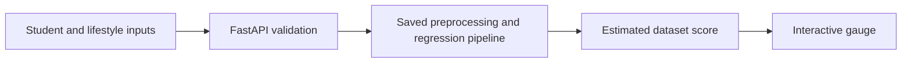

# Student Mental Health Score Predictor

An interactive educational app that estimates the `Mental_Health_Score` used in a student social media and lifestyle dataset. It combines a scikit-learn regression pipeline, a FastAPI API, and a responsive frontend.

**[Live demo](https://mental-health-predictor-wtdl.onrender.com/)** · **[API documentation](https://mental-health-predictor-wtdl.onrender.com/docs)** · **[Training notebook](ML_Project.ipynb)**

   

> **Educational use only.** The score is a prediction of a dataset column. It is not a diagnosis, screening tool, or measure of an individual's clinical mental health.

## What it does

The form collects self-reported study, social media, sleep, physical activity, and stress information. It returns an estimated score on the dataset's 0–10 scale. **Try an example** fills the form with sample values so the full flow can be explored quickly.



## Model and data

| Item | Detail |
| --- | --- |
| Task | Regression to the dataset's `Mental_Health_Score` column |
| Data | `Student Social Media And Mental Health Impact.csv` in this repository; 5,000 records |
| Inputs | Age, gender, country group, academic level, most-used platform, purpose of use, screen time, phone unlocks, study time, physical activity, sleep, and perceived stress |
| Model | scikit-learn preprocessing pipeline with a random forest regressor, saved as `Mental_Health_Model.pkl` |
| Evaluation | **0.878 R²** and **0.347 MAE** on the notebook's 30% test split for the saved default random forest pipeline |

The notebook covers exploration, cleaning, feature preparation, regression comparisons, and evaluation. The API maps country names to the same groups used during training and loads the saved pipeline for inference.

The repository does not establish that this dataset score is clinically validated or that predictions generalize to new populations. The app should be used to demonstrate ML deployment, not to make health decisions.

## Run locally

Use Python 3.12.7. From the repository root:

```bash
python -m venv .venv
python -m pip install -r requirements.txt
python -m uvicorn main:app --reload
```

Open **http://127.0.0.1:8000**. Select **Try an example**, then **Read my signal**. The API is documented at `/docs`, and `/health` returns service status.

### API response

`POST /predict` accepts the fields shown in the form as JSON. A successful response has this shape:

```json
{
  "predicted_mental_health_score": 7.29
}
```

The number above is an example, not a diagnosis or a cutoff for any health category.

## Project files

| File | Purpose |
| --- | --- |
| `main.py` | FastAPI routes, validation, country grouping, and inference |
| `index.html`, `style.css`, `script.js` | Responsive interactive frontend |
| `Mental_Health_Model.pkl` | Trained preprocessing and regression pipeline |
| `ML_Project.ipynb` | Exploration, training, and evaluation |
| `Student Social Media And Mental Health Impact.csv` | Dataset used in the notebook |
| `render.yaml`, `.python-version` | Render Free service and Python runtime configuration |

## Deployment

The live service deploys from this repository on Render Free. The `render.yaml` file records the build command, Uvicorn start command, and health check. Free services may sleep after 15 minutes of inactivity, so the first visit after a quiet period can take about a minute.
